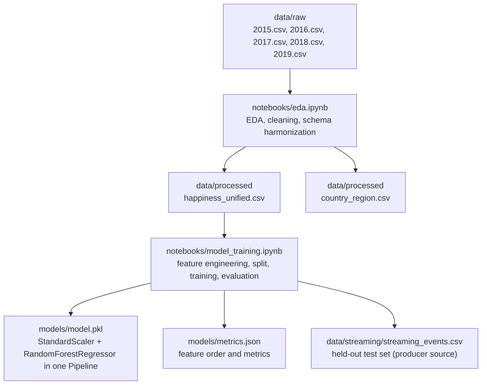
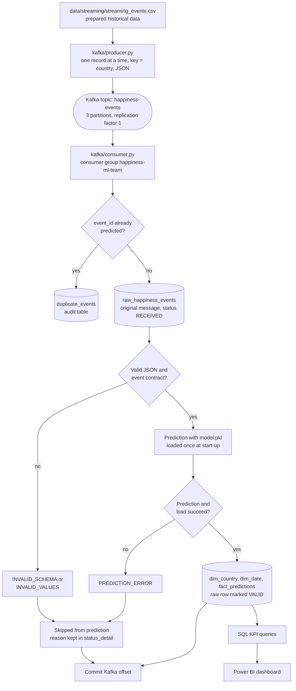
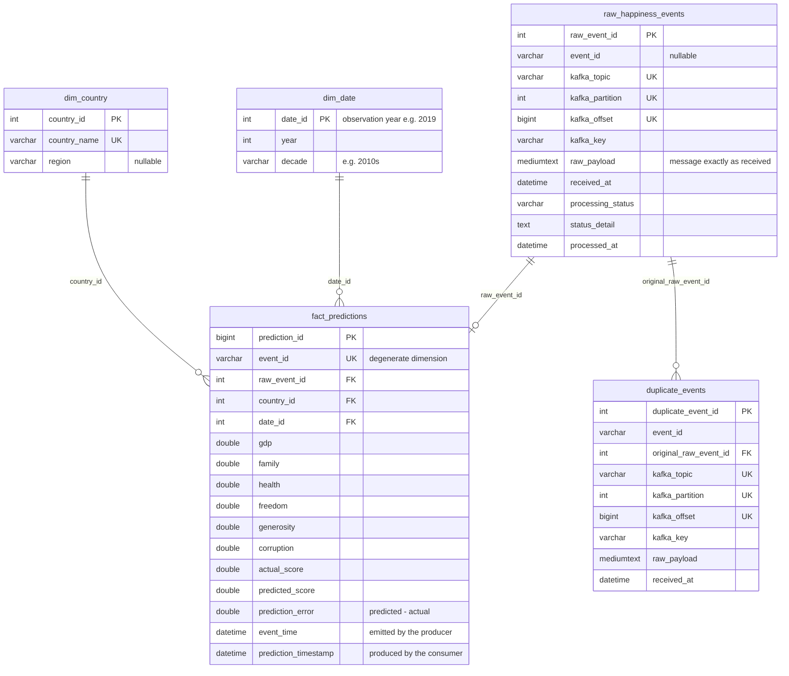

# Workshop 3. Streaming ETL with Apache Kafka and Machine Learning

`Juan David Lasso Chaparro`

This repository turns a classic batch ETL into an event-driven streaming pipeline that produces real-time predictions. The five World Happiness Report files are harmonized and used to train a regression model. A Kafka producer replays historical records as events, and a Kafka consumer stores each raw event, validates it against an explicit event contract, predicts the happiness score with the serialized model and loads the result into MySQL.

## Contents

1. [Project description](#1-project-description)
2. [Architecture](#2-architecture)
3. [Data cleaning decisions](#3-data-cleaning-decisions)
4. [Feature engineering decisions](#4-feature-engineering-decisions)
5. [Kafka pipeline and event contract](#5-kafka-pipeline-and-event-contract)
6. [Database schema](#6-database-schema)
7. [Dashboard explanation](#7-dashboard-explanation)
8. [Execution instructions](#8-execution-instructions)
9. [Troubleshooting](#9-troubleshooting)
10. [Assumptions and limitations](#10-assumptions-and-limitations)
11. [Repository structure](#11-repository-structure)

---

## 1. Project description

This project turns a classic batch ETL into an event-driven streaming pipeline that produces real-time predictions.

1. **Offline (batch) part.** The five World Happiness Report files, which do not share the same schema, are profiled, cleaned and harmonized into one unified dataset. A regression model that predicts the happiness score from six factors is trained, evaluated and serialized (together with its preprocessing) in `models/model.pkl`. A country-to-region catalog (`data/processed/country_region.csv`) is also generated and used by the consumer to populate `dim_country`.
2. **Streaming part.** A Kafka producer replays historical records one by one as events. A Kafka consumer stores every raw event, validates it against an explicit event contract, applies the same preprocessing used in training, predicts the happiness score and stores the result in MySQL.
3. **Analytics part.** The predictions are modelled as a small star schema (`fact_predictions`, `dim_country`, `dim_date`) and a dashboard reads the database to provide organized analytic information to be interpreted.

---

## 2. Architecture

### Offline process (batch)

The offline part prepares the data and produces the artifacts that the streaming part needs.



### Streaming process

The producer reads the prepared historical data, not the raw files. Every message goes through the same path in the consumer, and every path ends by committing the Kafka offset.



### Component responsibilities

| Component | Responsibility |
|---|---|
| Kafka | Transports and retains events (partitions, offsets, consumer group). It does not know what an event means. |
| `kafka/producer.py` | Reads the prepared records one by one, builds the JSON event, sets `event_time` at emission and publishes it with `country` as the key. |
| `kafka/consumer.py` | Owns raw storage, duplicate detection, validation, preprocessing, inference and persistence. The event contract validation logic lives here. |
| `kafka/settings.py` | Single source of truth for all shared settings: topic, group, feature order, valid ranges and database credentials. Used by the producer, the consumer and the notebooks. |
| MySQL | Persists the trusted result (facts and dimensions), the evidence of every message that arrived (raw table) and the duplicate audit table. |
| `models/model.pkl` | Preprocessing and model in one object, so training and serving cannot drift apart. |
| `models/metrics.json` | Feature names in training order, evaluation metrics and scikit-learn version. Used by the consumer to validate the model at start-up. |
| `sql/create_tables.sql` | Idempotent DDL executed once by Docker and again by the consumer if tables are missing. |
| `sql/create_bi_user.sql` | Creates a read-only `powerbi` user for Power BI. Executed once by Docker. |
| `sql/kpis.sql` | Queries that feed the dashboard. |

**Two kinds of persistence.** Kafka keeps the event *log* (replay); MySQL keeps the *application result* (SQL and dashboard). Kafka is not used as a replacement for the database.

---

## 3. Data cleaning decisions

Full evidence and code are in `notebooks/eda.ipynb`. The raw files have these data quality problems and decisions:

| Problem found | Decision | Why |
|---|---|---|
| Three naming conventions for the same variables (four column layouts in total); 2017 also changes the column order | Explicit per-year rename dictionary, selecting columns by name | Concatenating by position would silently swap `generosity` and `corruption` in 2017 |
| `Region`, standard error, confidence intervals, whiskers and `Dystopia Residual` exist only in some years | Keep only the columns common to all five years | A model and an event contract can only rely on fields that always exist |
| `Dystopia Residual` and `Happiness Rank` are derived from the target | Excluded from modelling | Target leakage (score = six factors + dystopia residual) |
| Country-name variants across years (`Hong Kong S.A.R., China`, `Taiwan Province of China`, `Trinidad & Tobago`, `Northern Cyprus`, `Macedonia`, `Somaliland region`) | Explicit canonical-name mapping | Prevents merging different countries; fuzzy matching could create false equivalences |
| 1 missing value: `corruption` of United Arab Emirates 2018 | Mean of the same country's 2017 and 2019 values | Keeps the record, uses only dataset values, and that country's series is smooth |
| 2017 stores 14-15 decimals of floating-point noise | Round every factor and the score to 5 decimals | Same precision in every year |
| Countries missing in some years | Not filled | Their absence is real survey coverage; inventing rows would create fake observations |
| `Region` column missing from 2018 and 2019 | Inferred from previous years and saved to `data/processed/country_region.csv` | Makes the region available for `dim_country` without hardcoding it in the consumer |

**Result:** `data/processed/happiness_unified.csv`, 782 rows, no nulls, unique (`country`, `year`). The notebook ends with assertions that verify these properties.

---

## 4. Feature engineering decisions

Full detail in `notebooks/model_training.ipynb`.

- **Features:** `gdp`, `family`, `health`, `freedom`, `generosity`, `corruption`. They exist in every year and are exactly the numeric fields carried by the streaming event, so the consumer can always build the model input.
- **Target:** `happiness_score` (`actual_happiness_score` in the event). It is never a model input: in streaming it is only used afterwards to compute the prediction error.
- **Excluded:** `happiness_rank` (leakage), `region` (not present in all source years), `country` (identifier with many unique values; the model would memorize countries), `year` (no meaningful temporal signal for regression).
- **Categorical data:** none after the selection, so no encoding is needed.
- **Scaling:** `StandardScaler` inside the Pipeline, so the exact training statistics are serialized with the model.
- **Split:** approximately 70 % / 30 %, grouped by country (547 / 235 rows). A country appears in up to five years with similar values; a plain random split would leak it into the test set.
- **Model selection:** `RandomForestRegressor` was selected and trained on the grouped split.

| Metric (test set) | Value |
|---|---|
| MAE | 0.3983 |
| RMSE | 0.5086 |
| R² | 0.7976 |

The producer streams the held-out test set (235 events), so the dashboard shows an honest error and not an optimistic one measured on training rows.

---

## 5. Kafka pipeline and event contract

### Topic and clients

| Item | Value |
|---|---|
| Topic | `happiness-events`: 3 partitions, replication factor 1 (single local broker) |
| Event key | `country` (events of the same country go to the same partition, preserving their order) |
| Value | JSON |
| Consumer group | `happiness-ml-team` |
| Offset handling | `enable_auto_commit = False`; the offset is committed **after** the database work |
| Topic creation | Done by `docker-compose.yml` via `kafka-init` service, and also by `producer.py` / `consumer.py` as a fallback, so the 3-partition design is never replaced by a broker default |

### Producer (`kafka/producer.py`)

Reads the prepared historical data record by record, builds the event, sets `event_time` to the moment of emission and publishes it, waiting a configurable delay between records (default 0.5 s). The CSV is a bounded source; the delay only simulates data arriving over time.

```powershell
python kafka/producer.py                  # 0.5 s between events (default)
python kafka/producer.py --delay 0.1      # faster
python kafka/producer.py --limit 20       # only first 20 events (testing)
```

### Event contract

Defined and validated in `kafka/consumer.py`, using the shared constants from `kafka/settings.py` as the single source of truth for field names, valid ranges and feature order.

```json
{
  "event_id": "E001", "country": "Colombia", "year": 2019,
  "gdp": 1.2, "family": 0.8, "health": 0.9, "freedom": 0.6,
  "generosity": 0.3, "corruption": 0.1,
  "actual_happiness_score": 6.2,
  "event_time": "2026-11-13T15:30:00"
}
```

| Field | Type | Rule |
|---|---|---|
| `event_id` | string | Required, non-empty, max 100 characters; unique among accepted events |
| `country` | string | Required, non-empty, max 150 characters; must match the Kafka key |
| `year` | integer | Required; in range 2000–2100 |
| `gdp`, `family`, `health`, `freedom`, `generosity`, `corruption` | number | Required, finite, in range 0.0–3.0 |
| `actual_happiness_score` | number | Required, finite, in range 0.0–10.0. Used only for evaluation, never as a model input |
| `event_time` | string | Required, ISO-8601 timestamp: when the producer emitted the event |

### Consumer (`kafka/consumer.py`)

The model is loaded once at start-up, and the consumer refuses to start if the feature order stored in `model.pkl` differs from `FEATURES` in `settings.py`. For every message, in this order:

1. Check if this exact Kafka message (topic + partition + offset) is already in the raw table or in `duplicate_events`. If so, skip without reprocessing.
2. Check if the `event_id` already has a prediction in `fact_predictions`. If yes, store the message in `duplicate_events` and stop.
3. Store the original message in `raw_happiness_events` with status `RECEIVED`, before any validation or prediction.
4. Parse the JSON and validate the contract (required fields, types, value ranges, key/country match).
5. Build the feature row in the training order defined in `settings.py`.
6. Predict with the serialized Pipeline.
7. Store dimensions, the fact row and the final status in one transaction.
8. Commit the Kafka offset.

| Status in the raw table | Meaning |
|---|---|
| `RECEIVED` | Initial state, set when the raw message is stored |
| `VALID` | Passed the contract and was predicted; a row exists in `fact_predictions` |
| `INVALID_SCHEMA` | Not JSON / not an object, missing or null field, wrong type, empty string, bad timestamp |
| `INVALID_VALUES` | Right structure but impossible values: NaN, infinity, out-of-range feature or score, key mismatch |
| `PREDICTION_ERROR` | Contract passed, but the model or the load step failed for this event |

Duplicate events (same `event_id` as an already-predicted event) are **not** a status of the raw table: they are stored in the separate `duplicate_events` audit table, so `fact_predictions` never accumulates duplicates.

Invalid events are stored in the raw table, skipped from prediction and never stop the pipeline; the reason is kept in `status_detail`.

**Reliability behaviours implemented**

- A redelivered Kafka message (same topic, partition and offset, for example after a crash before the offset commit) is detected by the unique constraint on `(kafka_topic, kafka_partition, kafka_offset)` in both `raw_happiness_events` and `duplicate_events` and is not processed twice.
- If the database is down, the consumer fails without committing the offset, so no event is silently skipped.

---

## 6. Database schema

Created by `sql/create_tables.sql` in MySQL 8.0 (InnoDB, utf8mb4). The raw table and the duplicate table are staging and audit tables, not dimensions.



- **Traceability:** every prediction links to the exact Kafka message through `raw_event_id` (and from there to topic, partition and offset).
- **`dim_date`** uses the observation year as the natural key (`date_id = year`). The `decade` column enables decade-level grouping in the dashboard.
- **`dim_country`** includes a `region` column populated from `data/processed/country_region.csv` (generated by the EDA notebook).
- The raw payload is stored as `MEDIUMTEXT` on purpose: it preserves the message exactly as it arrived, including malformed JSON.
- `fact_predictions` holds one row per event that was validated and predicted successfully; rejected events exist only in the raw table, and duplicate events only in `duplicate_events`.
- A read-only `powerbi` user (`sql/create_bi_user.sql`) is created by Docker to let Power BI connect directly with minimal privileges.

---

## 7. Dashboard explanation

The dashboard imports its data from the MySQL queries in `sql/kpis.sql`, loaded as native SQL queries in Power BI. It is a snapshot of the database: after running the pipeline.

| KPI | Query in `kpis.sql` | Visual | How to read it |
|---|---|---|---|
| 1. Average prediction error | KPI 1 | KPI cards: MAE, RMSE, Mean Bias, Total predictions | Measures the magnitude and direction of prediction errors in happiness-score points. A positive bias indicates over-prediction and a negative bias indicates under-prediction. |
| 2. Predictions by country | KPI 2 | Horizontal bar chart | Shows the number of test-set predictions for each country, with region, country-level MAE and average actual and predicted scores. |
| 3. Predicted vs actual score | KPI 3 | Scatter plot | Each point represents an individual country-year prediction. Points closer to the reference diagonal indicate more accurate predictions. |
| 4. Prediction trends over time | KPI 4a and 4b | Two line charts | The first chart compares average actual and predicted scores by historical observation year (2015–2019); the second shows the running MAE over processing time during streaming. |
| 5. Distribution of event processing status | Extra query | Donut chart | Shows the distribution of incoming raw events by processing status (VALID, INVALID_SCHEMA, INVALID_VALUES, PREDICTION_ERROR, DUPLICATE_EVENT). |

**KPI explanations**

- **Mean Absolute Error (MAE):** measures the average absolute difference between predicted and actual happiness scores, expressed in score points.

- **Root Mean Squared Error (RMSE):** measures the square root of the average squared prediction errors. Unlike MAE, it gives greater weight to larger prediction mistakes.

- **Mean Error Bias:** represents the average of `predicted_score − actual_score`. A positive value indicates that the model tends to over-predict, while a negative value indicates under-prediction. A value close to zero indicates little systematic bias.

- **Predictions by Country:** counts the successfully processed predictions for each country, grouped by region. Since the test set contains historical observations from 2015 to 2019, each country can contribute up to five predictions. Some countries have fewer observations because they are not present in every yearly dataset.

- **Actual vs. Predicted Happiness Score:** compares the actual happiness score against the model's predicted score for each individual observation. The distance from the reference diagonal indicates the prediction error.

- **Prediction Trends:** provides two temporal perspectives. The yearly chart compares average actual and predicted happiness scores across historical observation years (2015–2019), while the streaming chart shows the running MAE across the processing order.

- **Event Processing Status:** monitors the quality of incoming Kafka events. The chart distinguishes VALID, INVALID_SCHEMA, INVALID_VALUES, PREDICTION_ERROR and DUPLICATE_EVENT counts, combining `raw_happiness_events` and `duplicate_events`.

**Dashboard file**

- Power BI file: `dashboards/Dashboard.pbix`

---

## 8. Execution instructions

Commands are written for Windows 11 + Docker Desktop + PowerShell and Python 3.12. Run every command from the project root.

### 1. Python environment

```powershell
python -m venv .venv
.\.venv\Scripts\Activate.ps1
python -m pip install -r requirements.txt
```

### 2. Offline process (already executed; re-run only to regenerate)

Open and press Run All, in this order, `notebooks/eda.ipynb` and then `notebooks/model_training.ipynb` (while inside the virtual environment, kernel = the `.venv`). They write `data/processed/`, `data/streaming/` and `models/`.

### 3. Start Kafka and MySQL

```powershell
docker compose up -d
docker compose ps
```

This also runs `kafka-init`, which creates the `happiness-events` topic (3 partitions, replication factor 1), and initializes the MySQL database by running `sql/create_tables.sql` and `sql/create_bi_user.sql` automatically.

### 4. Run the streaming pipeline (two terminals, both with the virtual environment active)

```powershell
# Terminal 1 - consumer (stays running; Ctrl+C to stop)
python kafka/consumer.py

# Terminal 2 - producer: sends all 235 test-set events
python kafka/producer.py
```

### 5. Inspect Kafka and the database

```powershell
# Topic layout
docker compose exec kafka /opt/kafka/bin/kafka-topics.sh --describe --topic happiness-events --bootstrap-server localhost:9092

# Consumer group position and lag
docker compose exec kafka /opt/kafka/bin/kafka-consumer-groups.sh --bootstrap-server localhost:9092 --describe --group happiness-ml-team

# Events by processing status
docker compose exec mysql mysql -uhappiness -phappiness happiness -e "SELECT processing_status, COUNT(*) AS total FROM raw_happiness_events GROUP BY processing_status UNION ALL SELECT 'DUPLICATE_EVENT', COUNT(*) FROM duplicate_events ORDER BY total DESC;"

# Average prediction error KPI
docker compose exec mysql mysql -uhappiness -phappiness happiness -e "SELECT COUNT(*) AS total_predictions, ROUND(AVG(ABS(prediction_error)),4) AS mae, ROUND(SQRT(AVG(POWER(prediction_error,2))),4) AS rmse, ROUND(AVG(prediction_error),4) AS mean_bias FROM fact_predictions;"

# Traceability: each prediction linked to its raw event
docker compose exec mysql mysql -uhappiness -phappiness happiness -e "SELECT f.prediction_id, f.raw_event_id, f.event_id, f.actual_score, f.predicted_score, f.prediction_error FROM fact_predictions f LIMIT 5;"

# Key routing: events per partition
docker compose exec mysql mysql -uhappiness -phappiness happiness -e "SELECT kafka_partition, COUNT(DISTINCT kafka_key) AS keys, COUNT(*) AS events FROM raw_happiness_events GROUP BY kafka_partition ORDER BY kafka_partition;"

# Consistency: VALID raw events = fact rows
docker compose exec mysql mysql -uhappiness -phappiness happiness -e "SELECT (SELECT COUNT(*) FROM raw_happiness_events WHERE processing_status='VALID') AS raw_valid, (SELECT COUNT(*) FROM fact_predictions) AS fact_rows;"
```

### 6. Dashboard

Open `dashboards/Dashboard.pbix` in Power BI Desktop and refresh the data sources. Power BI connects to MySQL using the `powerbi` read-only user (host `localhost`, port `3307`, database `happiness`, user `powerbi`, password `powerbi`).

### Stop and reset

```powershell
docker compose down        # stops containers; MySQL data is kept in a volume
docker compose down -v     # also deletes the MySQL volume: a clean start
```

Kafka data is **not** kept after `docker compose down` (single-broker teaching environment without a volume). Re-running the producer while the containers are still running is fine: the new messages get new offsets, and the repeated `event_id`s are stored as `DUPLICATE_EVENT` without creating new predictions. Always use `docker compose down -v` for a clean start before re-running the full pipeline from scratch.

---

## 9. Troubleshooting

| Symptom | Likely cause / fix |
|---|---|
| `NoBrokersAvailable` or connection refused on port 9092 | Container not running yet: `docker compose ps`, then wait a few seconds for the healthcheck to pass |
| `Topic 'happiness-events' exists with 1 partition but 3 are required` | The topic was auto-created by another client before `kafka-init` ran. `docker compose down -v` and start again |
| Every message reprocessed on consumer restart | Kafka offsets are reset because Kafka data was lost. `docker compose down -v` and start again |
| `Waiting for MySQL...` for a long time | `docker compose logs mysql`; port 3307 may already be used by a local service (change the host port in the compose file and set `MYSQL_PORT`) |
| `models/model.pkl not found` | Run `notebooks/model_training.ipynb` first |
| `The model expects [...] but the contract defines [...]` | The model was trained with a different feature list. Retrain with `notebooks/model_training.ipynb` |
| Error unpickling `model.pkl` | The scikit-learn version differs from `requirements.txt`; reinstall the pinned versions |
| Power BI cannot connect to MySQL | Confirm the MySQL container is running on port 3307; the `powerbi` user is created by `sql/create_bi_user.sql` only on first container start. If the volume already existed without that file, `docker compose down -v` and start again |
| Connection settings | Override with environment variables: `KAFKA_BOOTSTRAP_SERVERS`, `MYSQL_HOST`, `MYSQL_PORT`, `MYSQL_DATABASE`, `MYSQL_USER`, `MYSQL_PASSWORD` |

---

## 10. Assumptions and limitations

- The numeric ranges of the event contract (factors 0–3, score 0–10, year 2000–2100), the grouped-by-country split and the imputation of the single missing value are decisions justified by data observation documented in the EDA notebook.
- `dim_date` uses the observation year as its natural key instead of a calendar date, because the source data is annual. The `decade` column is added as the only time hierarchy available.
- `dim_country` stores a `region` column populated from `country_region.csv`, which was generated by the EDA notebook from the region information available only in some years of the original data.
- Duplicate events are separated into their own `duplicate_events` table (instead of a status in the raw table) so that the unique constraint on `event_id` in `fact_predictions` is never violated and the raw table remains a clean audit log of non-duplicate messages.
- The pipeline is a teaching environment: a single Kafka broker without data volume persistence and a single MySQL instance. It is not designed for production availability or horizontal scaling.
- The focus of the workshop is pipeline integration, not maximizing model accuracy. The RandomForestRegressor was selected without exhaustive hyperparameter tuning.

---

## 11. Repository structure

```text
├── data/
│   ├── raw/                                        # original files, never modified
│   │   ├── 2015.csv
│   │   ├── 2016.csv
│   │   ├── 2017.csv
│   │   ├── 2018.csv
│   │   └── 2019.csv
│   ├── processed/
│   │   ├── happiness_unified.csv                   # clean unified dataset (782 rows, no nulls)
│   │   └── country_region.csv                      # country → region catalog (feeds dim_country)
│   └── streaming/
│       └── streaming_events.csv                    # held-out test set (producer source, 235 rows)
├── notebooks/
│   ├── eda.ipynb                                   # EDA, cleaning and harmonization (Steps 1-2)
│   └── model_training.ipynb                        # feature engineering, training, evaluation (Steps 3-4)
├── kafka/
│   ├── producer.py                                 # reads streaming_events.csv, publishes JSON events
│   ├── consumer.py                                 # validation, inference and persistence
│   └── settings.py                                 # single source of truth for all shared settings
├── models/
│   ├── model.pkl                                   # StandardScaler + RandomForestRegressor Pipeline
│   └── metrics.json                                # feature order, evaluation metrics, sklearn version
├── sql/
│   ├── create_tables.sql                           # idempotent DDL (MySQL 8, InnoDB)
│   ├── create_bi_user.sql                          # read-only powerbi user for Power BI
│   ├── kpis.sql                                    # dashboard KPI queries
│   └── dimensional_model.mermaid                   # ER diagram source
├── dashboards/
│   ├── Dashboard.pbix                              # Power BI file
│   └── screenshots/                               # dashboard screenshots
├── docker-compose.yml                              # Kafka (KRaft, 3.8.0) + MySQL 8.0 + kafka-init
├── requirements.txt
├── .gitignore
└── README.md
```
